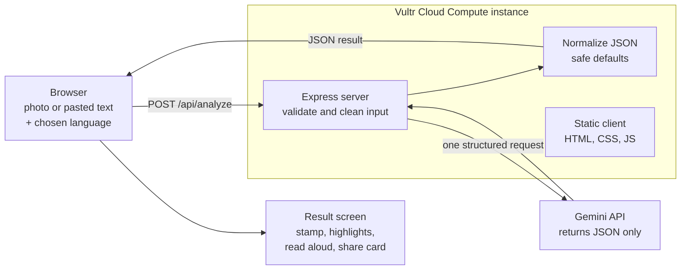

# Plainly

**Snap a confusing letter, bill or text message. Get a plain-language answer in your language, read aloud, with a scam check.**

Built by **npm install victory** for HackGlobal 2026.

| | |
|---|---|
| Live demo on Vultr | https://149-28-226-182.sslip.io/ |
| Demo used in our submission (Render) | https://plainly-hackglobal.onrender.com/ |
| Hackathon track | Civic and real-world impact |

---

## The problem

Official letters, bills and SMS alerts are written in language most people never learned to read. Scammers copy that style on purpose, using fake urgency and fake links, and people lose money because they cannot tell the real notice from the fake one.

Plainly does two jobs in one step:

1. **Explains** what the message wants, how much, and by when, in plain words.
2. **Warns** when the message looks like a scam, and says exactly what to do next.

---

## What it does

- Upload a photo, take one with the camera, paste a screenshot, or paste text
- Explains in your language: English, Spanish, French, Portuguese, Tagalog, Mandarin, Arabic, Hindi, German, Yoruba, Nigerian Pidgin, Hausa, Igbo and Swahili
- Rates the message **SAFE**, **SUSPICIOUS** or **LIKELY SCAM** as a rubber stamp
- Highlights the confusing or suspicious phrases from the original
- Lists red flags and 2 to 4 clear next steps
- **Reads the explanation aloud**
- Makes a **shareable alert card** (PNG) so people can warn their friends and family
- **Voice dictation** on the text box, for people who find typing hard
- A live **impact counter** on the homepage: letters explained, scams flagged and countries reached

<!-- Add 3 screenshots here: upload screen, result with stamp, share card -->
<!--    -->

---

## How it works



**One request does everything.** The server sends the document and the language to the model once and asks for a fixed JSON shape. The server then checks that JSON and fills safe defaults before sending it to the browser, so the screen never breaks on a bad reply.

**The API key never reaches the browser.** It lives in `.env` on the server only.

---

## Tech stack

| Part | Choice |
|---|---|
| Frontend | Plain HTML, CSS and vanilla JavaScript (no framework) |
| Backend | Node.js 20+ and Express |
| Analysis | Gemini API, structured JSON output (`@google/genai`) |
| Read aloud and dictation | Browser Web Speech API |
| Impact counter | Totals saved in a small JSON file on the server |
| Share card | HTML5 canvas, exported as PNG |
| Hosting | Vultr Cloud Compute (Render for the original submitted demo) |

---

## Hosting and Vultr

Plainly now runs on a **Vultr Cloud Compute instance**: https://149-28-226-182.sslip.io/

**What happened, stated plainly.** Our event credit did not appear on the Vultr account before the deadline, so we could not deploy there. We submitted with a demo on Render's free tier (https://plainly-hackglobal.onrender.com/). The credit appeared after the deadline, and on 15 November 2026 we deployed the same code on Vultr. No application code was changed after the deadline. We only updated this README and added the deploy script.

**How the Vultr instance works.** One Node.js and Express process runs under pm2, with Caddy in front for automatic HTTPS. It serves the client and the `/api` routes, keeps the Gemini API key in its environment, and holds the impact counter file. The repo includes `deploy/vultr-cloud-init.sh`, a cloud-init script for this setup (Ubuntu 24.04, smallest plan).

---

## Project structure

```
.
├── client/
│   ├── index.html        # page layout
│   ├── styles.css        # paper, highlighter and stamp styling
│   └── app.js            # upload, language, results, audio, share card
├── server/
│   ├── index.js          # Express app: serves client and the API
│   ├── routes/
│   │   └── analyze.js    # POST /api/analyze: validates input
│   └── services/
│       └── gemini.js     # prompt, JSON schema, model call, result cleanup
├── .env.example          # environment variable names
├── .gitignore
├── package.json
└── README.md
```

---

## Run it locally

You need Node.js 20 or newer and an API key for the Gemini API.

```bash
git clone https://github.com/HighPriest19/plainly-hackglobal
cd plainly-hackglobal
npm install
cp .env.example .env
```

Open `.env` and set your key:

```
GEMINI_API_KEY=your_api_key_here
```

Start the server:

```bash
npm start
```

Open <http://localhost:3000>. Use the sample buttons on the page to try a bill, a scam text and a collections notice.

### Environment variables

| Name | Required | What it does |
|---|---|---|
| `GEMINI_API_KEY` | Yes | Key for the analysis service. Server only. |
| `PORT` | No | Port to listen on. Defaults to `3000`. |

---

## API

### `GET /api/health`

Returns `{"ok":true}`. Use it to check that the server is up.

### `POST /api/analyze`

Send pasted text, a photo, or both.

| Field | Type | Notes |
|---|---|---|
| `text` | string | Optional if `imageBase64` is sent. Trimmed to 15,000 characters. |
| `imageBase64` | string | Optional if `text` is sent. Base64 only, no `data:` prefix. |
| `mimeType` | string | Required with an image: `image/jpeg`, `image/png`, `image/webp` or `image/gif`. |
| `language` | string | Optional. Defaults to `English`. Max 40 characters. |

The request body limit is 8 MB. The browser compresses photos before sending.

**Example request**

```bash
curl -X POST http://localhost:3000/api/analyze \
  -H "Content-Type: application/json" \
  -d '{"text":"USPS-ALERT: Your parcel is held. Pay $14.95 at http://usps-parcel-track-99.vip/pay within 12 hours.","language":"English"}'
```

**Example response** (real output from a test run)

```json
{
  "documentType": "Delivery SMS",
  "whatItWants": "The message claims a package is being held and asks you to click a link to pay a fee right away.",
  "deadline": "Within 12 hours",
  "amount": "$14.95",
  "scamRisk": "likely_scam",
  "redFlags": [
    "Fake website link that does not belong to the real usps.com website",
    "The link uses an unsecure http address instead of https",
    "Fake urgency trying to rush you with a 12-hour deadline",
    "Asks for a sudden payment to release a package"
  ],
  "nextSteps": [
    "Do not click the link or enter your payment information.",
    "Delete the text message and block the number.",
    "If you are waiting for a package, go directly to usps.com to check your tracking number."
  ],
  "plainExplanation": "This text message pretends to be from the United States Postal Service, but it is almost certainly a scam. ...",
  "confusingPhrases": [
    "USPS-ALERT",
    "Your parcel is held",
    "http://usps-parcel-track-99.vip/pay",
    "within 12 hours"
  ]
}
```

`scamRisk` is always one of `safe`, `suspicious` or `likely_scam`. If the model returns anything else, the server falls back to `suspicious`.

**Errors**

| Status | When |
|---|---|
| 400 | No text and no photo, or the image type is not allowed |
| 429 | Too many requests from one IP address in a short time |
| 500 | Server key is missing, or the analysis failed |

---

## Deploy on Vultr

These are the manual steps for a fresh Ubuntu instance on Vultr Compute, run over SSH. To skip SSH, paste `deploy/vultr-cloud-init.sh` into the Cloud-Init User Data field when you deploy.

**1. Install Node.js 20**

```bash
curl -fsSL https://deb.nodesource.com/setup_20.x | sudo -E bash -
sudo apt-get install -y nodejs git
```

**2. Get the code and install**

```bash
git clone https://github.com/HighPriest19/plainly-hackglobal
cd plainly-hackglobal
npm install --omit=dev
cp .env.example .env
nano .env
```

**3. Keep it running with pm2**

```bash
sudo npm install -g pm2
pm2 start server/index.js --name plainly
pm2 save
pm2 startup
```

Run the command that `pm2 startup` prints, so the app restarts after a reboot.

**4. Open the port**

```bash
sudo ufw allow 3000/tcp
```

The app is now live at `http://YOUR_SERVER_IP:3000`.

**5. Use HTTPS for the live demo.** The share button and clipboard fallback only work on secure pages. Put nginx in front of the app with a free certificate, or use a domain pointed at the instance.

The server uses `app.set("trust proxy", 1)` so the rate limiter sees each visitor's real IP. That is correct only when nginx (or another proxy) sits in front of the app. If you expose port 3000 directly, remove that line, or visitors can fake their IP.

---

## Privacy

- **We don't save your documents.** Photos and text are sent to our server, forwarded to the analysis model, and dropped once the result is returned. Nothing is written to a database or to disk, and there are no accounts.
- **The analysis is done by an AI model.** The Gemini API reads each document. While we use the free quota, Google may use submitted content to improve its products, and reviewers may read it. For that reason, **do not upload IDs, bank details, passwords or other sensitive documents** while testing.
- Server logs record error messages only, never document contents.
- The impact counter stores totals only (letters explained, scams flagged, and an optional country count), never documents or photos.

---

## Design decisions

- **No framework.** The whole client is three files you can read in one sitting.
- **One model call per document.** Faster, cheaper and easier to debug than a chain of calls.
- **Server cleans the model output.** The browser only ever sees the same JSON shape.
- **Read aloud uses the browser.** No audio files and no extra API cost.
- **Share card is drawn on a canvas.** No image server needed, and it works offline once loaded.

---

## Known limitations

- **Voices vary by device.** Some browsers have no voice for some languages, such as Tagalog or Hindi, so read aloud may be missing there.
- **HEIC photos.** Browsers without native HEIC support, such as desktop Chrome and Firefox, cannot read them. Use JPG, PNG or WebP.
- **Photo highlights.** For photo uploads, suspicious phrases are listed under the photo, not drawn on it. Pasted text is highlighted in place, first match per phrase.
- **No saved history.** Results live in the browser until refresh.
- **Basic rate limiting only.** Each IP address gets a small number of requests per 10 minutes to protect the API key. The counts live in server memory and reset on restart. There is no login.
- **Not legal or financial advice.** Plainly explains documents. Check with the sender directly through an official channel before paying anything.

---

## Credits

- [Gemini API](https://ai.google.dev/) for reading and explaining documents
- [Express](https://expressjs.com/) and [dotenv](https://github.com/motdotla/dotenv) on the server
- [Vultr](https://www.vultr.com/) for hosting
- Fonts: Fraunces and IBM Plex Mono, from Google Fonts
- Browser Web Speech API for read aloud and dictation

---

## Team: npm install victory

| Name | Role |
|---|---|
| Hinckley Olagunju | Full-stack developer: backend, AI integration, UI and deployment |
| Divine Ameh Abraham | Developer and team lead: frontend features, testing, user outreach and demo |
| Oluwatosin Olaleye | Tester |

---

## Impact and reach

Live numbers on the Vultr instance: https://149-28-226-182.sslip.io/impact
Live numbers on the Render demo used in our submission: https://plainly-hackglobal.onrender.com/impact

The two deployments keep separate counters. The snapshot below was taken from the Render demo.

Snapshot taken on 15 November 2026 at 08:44 WAT:

| Country | Users |
|---|---|
| Netherlands | 1 |
| Nigeria | 1 |
| United States | 1 |

Totals: 4 letters explained, 3 scams flagged, 3 countries reached. All 3 helpfulness ratings were positive (3 ratings is a small sample).

These are early numbers from a small test group. We have no user quotes yet.
